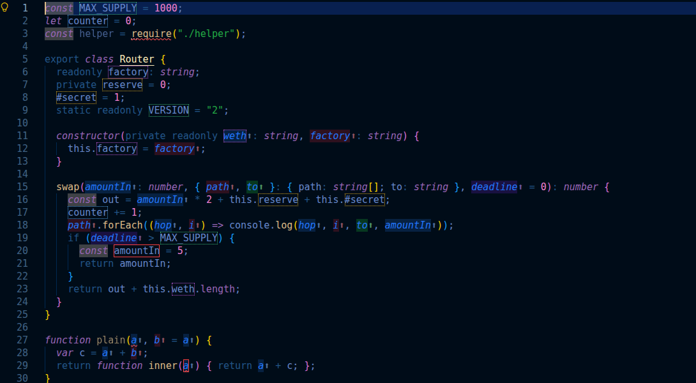
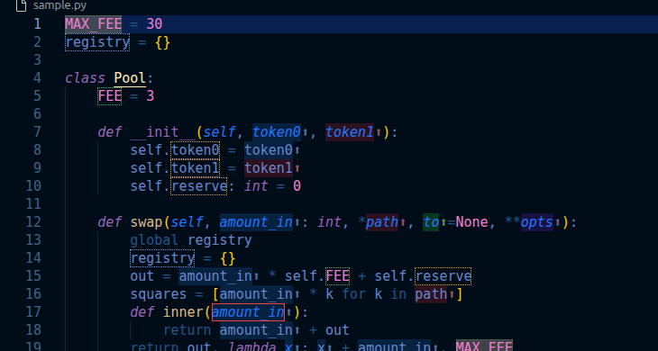
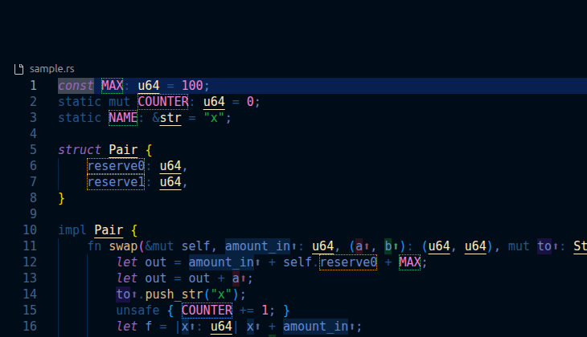

# All Code Visual

Semantic inline highlighting for the code you read every day, in the style of
[Solidity Visual Developer](https://github.com/ConsenSysDiligence/vscode-solidity-auditor),
brought to JavaScript, TypeScript, Python, Rust, Go, C, C++, Java, C#, PHP and Ruby. It
also ships a formatter for all of them.



## What you see

| Decoration | Meaning |
| --- | --- |
| Colored background + `⬆` | A function argument. Every argument of a function gets its own color, and every use of it inside the body carries the same color, so you can follow `token`, `amountIn` or `deadline` through a long body at a glance. Arguments of closures and lambdas are colored too. |
| Dotted goldenrod box | A field or struct member: `this.x`, `self.x`, a Go receiver's `r.x`, Ruby `@x`, and bare field names inside C++, Java and C# methods. |
| Dotted orchid box | A readonly field: TypeScript `readonly`, Java `final`, C# `readonly`, C++ `const` members, PHP `readonly`. |
| Dotted green box | A constant: `const`/`static` items, `#define`, `static final`, upper-case module and class constants. |
| Dotted blue box | Mutable module-level state: Go package `var`, C/C++ globals, Rust `static mut`, Python module variables, JS top-level `let`/`var`, Ruby `$globals`. |
| Solid red box | A declaration that shadows an argument, a local of an enclosing scope, a global, a constant or a field. |

Hover any decorated name to see what it is, its type or value when known, and a link to the
line where it is declared.

| Python | Rust |
| --- | --- |
|  |  |

## Languages

| Language | Arguments | Fields | Readonly | Constants | Globals | Default formatter |
| --- | --- | --- | --- | --- | --- | --- |
| JavaScript, JSX | ✓ | `this.x`, `#x` | | upper-case or literal `const` | top-level `let`/`var` | project Prettier, else bundled Prettier |
| TypeScript, TSX | ✓ | `this.x`, parameter properties | `readonly` | as JS, `static readonly` | as JS | project Prettier, else bundled Prettier |
| Python | ✓ (`self`/`cls` skipped) | `self.x`, class attributes | | upper-case names | module variables, `global` | `ruff format`, else `black` |
| Rust | ✓ (`self` skipped) | `self.x` | | `const`, `static` | `static mut` | `rustfmt` (edition from `Cargo.toml`) |
| Go | ✓ (receiver skipped) | `recv.x` | | `const` | package `var` | `gofmt` |
| C | ✓ | struct members | `const` members | `#define`, `const` globals | globals | `clang-format` |
| C++ | ✓ | implicit members, `this->x`, init lists, `Class::method` bodies | `const` members | `constexpr`, `static const` | globals | `clang-format` |
| Java | ✓ | implicit members, `this.x` | `final` | `static final` | | `google-java-format`, else `clang-format` |
| C# | ✓ | implicit members, `this.x`, properties | `readonly`, get-only properties | `const`, `static readonly` | | `clang-format` |
| PHP | ✓ | `$this->x`, promoted properties | `readonly` | `const`, `define()`, `self::X` | | bundled Prettier PHP plugin |
| Ruby | ✓ (blocks too) | `@x`, `@@x` | | `CONSTANT = ...` | `$x` | `rufo` |

## Formatter

All Code Visual registers itself as a document formatter for every language above. To use it,
pick it once with **Format Document With...** or set it as the default:

```jsonc
"[python]": { "editor.defaultFormatter": "0xshubhs.allcodevisual" },
"[rust]": { "editor.defaultFormatter": "0xshubhs.allcodevisual" }
```

You can also run **All Code Visual: Format Document** from the command palette without making
it the default.

- JavaScript, TypeScript and PHP work out of the box with the bundled Prettier. It reads JSON
  Prettier config (`.prettierrc`, `.prettierrc.json`, `package.json#prettier`) and otherwise
  follows the editor's indentation. When the workspace is trusted and has Prettier installed in
  `node_modules`, that copy is used instead, so your exact version and config apply.
- Every other language pipes the document through an installed CLI formatter. The first tool
  of the list that is installed wins. If none is installed you get one warning per language
  that tells you what to install.
- Override or add tools per language with `allCodeVisual.format.tools`. Each tool reads the
  document on stdin and writes the result to stdout:

```jsonc
"allCodeVisual.format.tools": {
  "python": [{ "command": "ruff", "args": ["format", "--stdin-filename", "${file}", "-"] }],
  "csharp": [{ "command": "csharpier", "args": ["format", "--write-stdout"] }],
  "ruby": [{ "command": "rufo", "args": [], "okExitCodes": [0, 3] }]
}
```

`${file}`, `${fileDirname}`, `${workspaceFolder}` and `${rustEdition}` are expanded in `args`.

## Settings

| Setting | Default | |
| --- | --- | --- |
| `allCodeVisual.enable` | `true` | Turn decorations on or off. |
| `allCodeVisual.languages` | all | Languages that get decorations. |
| `allCodeVisual.arguments.enable` | `true` | Argument colors. |
| `allCodeVisual.arguments.mode` | `color and symbol` | `color only` or `symbol only` are also available. |
| `allCodeVisual.arguments.suffix` | `⬆` | Symbol appended to arguments. |
| `allCodeVisual.arguments.paletteSize` | `15` | Distinct argument colors before they repeat. |
| `allCodeVisual.fields.enable` | `true` | Field and readonly field boxes. |
| `allCodeVisual.constants.enable` | `true` | Constant boxes. |
| `allCodeVisual.globals.enable` | `true` | Global variable boxes. |
| `allCodeVisual.shadowing.enable` | `true` | Shadowing warnings. |
| `allCodeVisual.hover.enable` | `true` | Hover explanations. |
| `allCodeVisual.overviewRuler.enable` | `false` | Show boxes in the overview ruler. |
| `allCodeVisual.maxFileSize` | `1000000` | Skip larger files (characters). |
| `allCodeVisual.debounce` | `200` | Milliseconds to wait after typing. |
| `allCodeVisual.format.enable` | `true` | Register the formatter. |
| `allCodeVisual.format.timeout` | `10000` | Milliseconds before an external formatter is stopped. |
| `allCodeVisual.format.tools` | `{}` | Formatter overrides, see above. |

Settings marked as language-overridable in the settings UI can be set per language, for
example `"[python]": { "allCodeVisual.globals.enable": false }`.

The box colors are theme colors (`allCodeVisual.fieldBorder`, `readonlyFieldBorder`,
`constantBorder`, `globalBorder`, `shadowBorder`) and can be changed in
`workbench.colorCustomizations`.

## Commands

- **All Code Visual: Toggle Decorations**
- **All Code Visual: Refresh Decorations**
- **All Code Visual: Format Document**
- **All Code Visual: Show Log**

## How it works

Each file is parsed with [tree-sitter](https://tree-sitter.github.io/) grammars compiled to
WebAssembly (the same `@vscode/tree-sitter-wasm` builds VS Code itself uses), so no language
server or toolchain is needed for the decorations. A single pass over the syntax tree builds
lexical scopes (modules, classes, functions, blocks, comprehensions, closures) with each
language's rules: Python's function-wide locals and `global`, JavaScript `var` hoisting, Rust
`let` rebinding, PHP and Ruby methods that cannot see outer locals, implicit `this` in C++, Java
and C#. Every identifier is then resolved against those scopes. Parsing and analysis of a
20,000 line file takes about a quarter of a second, and nothing runs until a supported file is
visible.

The analysis is syntactic: it does not know types, so `obj.x` on an arbitrary object is not
treated as a field, and names imported from other files are not followed. C is parsed with the
C++ grammar.

## Workspace trust

Decorations work in untrusted workspaces. In an untrusted workspace, formatter commands from
workspace settings and project-local Prettier binaries are not run; only tools configured in
your user settings and the bundled Prettier are used.

## Development

```sh
npm install
npm run build        # bundle to dist/ and copy the grammars
npm run test:unit    # analysis and formatter tests in Node
npm test             # integration tests in a downloaded VS Code
npm run vsix         # package the extension
```

Press F5 in VS Code to start an Extension Development Host on `test/fixtures`.

## Credits

The decoration style follows [Solidity Visual Developer](https://github.com/ConsenSysDiligence/vscode-solidity-auditor)
by tintinweb and ConsenSys Diligence. This extension is an independent implementation for other
languages and contains none of its code. Grammars come from
[@vscode/tree-sitter-wasm](https://github.com/microsoft/vscode-tree-sitter-wasm) and formatting
from [Prettier](https://prettier.io/) and the tools listed above.

## License

[MIT](LICENSE)
